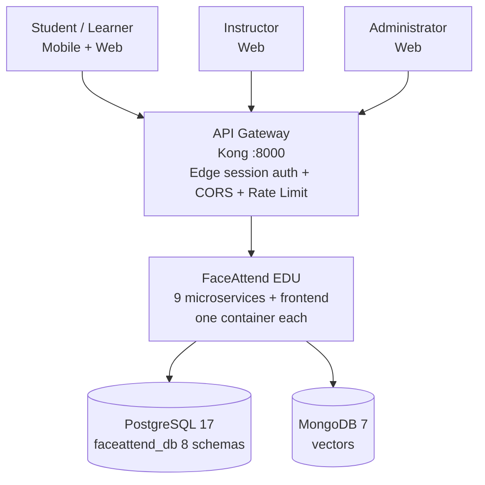
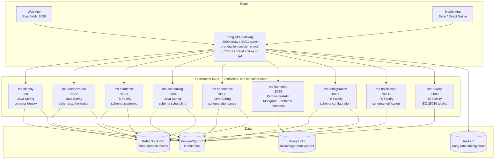

# System Architecture Overview

> **What to fill in here:** The architectural view is the technical snapshot of the system.
> It includes the C4 system and container diagram, service list, and architectural principles.
> This document is created after the main ADRs and guides the implementation.

---

## 1. Adopted architectural style

**Style:** **Microservices on a shared PostgreSQL instance (schema-per-context) + Event-Driven (Kafka)**

**Justification:** the 8 bounded contexts (02-domain) are separate deployables — one container and
one port each — plus a quality tooling service (`ms-quality`) behind Kong (`FULL/COMPOSE.md`).
ADR-002's modular-monolith reasoning still holds at the *data* level: a single `faceattend_db`
with schema-per-context, no cross-schema FK and DB-role isolation, so the boundaries can be
collapsed back if the deployment cost ever outweighs the benefit. Biometric vectors live in
MongoDB (the only polyglot exception, ADR-003). Events are published to a real Kafka broker
(KRaft, `:9092`) through `KafkaTemplate` (Java) and `kafkajs` (TS) — ADR-006, no longer
"Kafka-ready".

**Implementation note (2026-10-05):** ADR-002's "one deployable" is superseded in practice —
`docker compose` starts 9 microservices + Kong + frontend-web, each with its own healthcheck.
The decision (context boundaries, schema-per-context) is unchanged; only the packaging evolved.

**Reference ADRs:** `ADR-002` (module boundaries), `ADR-003` (biometric persistence), `ADR-006` (Kafka), `ADR-007` (API Gateway)

---

## 2. C4 Diagram — System Level (Context)

FaceAttend EDU serves a single educational institution (SENA cohort context). External actors are Students, Instructors, Administrators; external systems are none (future: institutional academic system).

---

## 3. C4 Diagram — Container Level (FaceAttend EDU)

One container per service, schema-per-context isolation, Kafka events at `:9092`. See `08-uml/diagrams/source/c4-container-example.md`.

---

## 4. Service catalog

| # | Service | Responsibility | Port | DB | Communication type |
|---|---------|---------------|------|-----|-------------------|
| 01 | ms-identity (+auth) | Person, user, authentication (opaque `sessionId`), sessions, city (legacy) | 8081 | PostgreSQL | REST + Kafka events |
| 02 | ms-authorization | Roles, permissions, role assignments | 8082 | PostgreSQL | REST + Kafka events |
| 03 | ms-academic | Schools, programs, courses, actors, enrollments | 8083 | PostgreSQL | REST + Kafka events |
| 04 | ms-scheduling | Environments, schedule blocks, class sessions | 8084 | PostgreSQL | REST + Kafka events |
| 05 | ms-attendance | Attendance records, justifications | 8085 | PostgreSQL | REST + Kafka events |
| 06 | ms-biometric | Facial/fingerprint embeddings + update cases | 8086 | MongoDB (+ SQL case) | REST |
| 07 | ms-configuration | Academic/security config values, biometric update cases | 8087 | PostgreSQL | REST + Kafka events |
| 08 | ms-notification | Alert types, alerts | 8088 | PostgreSQL | REST |
| 09 | ms-quality | ISO 25010/29110/ISTQB quality tooling (not a bounded context) | 8089 | PostgreSQL | REST |
| 99 | api-gateway (Kong OSS 3.6, DB-less) | Edge session authentication (global `pre-function`), routing, CORS, rate limiting (**no `jwt` plugin**) | 8000 / 8001 | Redis (rate-limit store) | HTTP Proxy |

> Full detail per service in `09-microservices/service-catalog.md`; ports and routes are frozen
> from `FULL/COMPOSE.md` + `FULL/back-end/99-api-gateway/kong/kong.yml`.

> **Corrected (2026-10-11, re-verified against `FULL/`):** services **03 (academic), 06
> (biometric), 07 (configuration), 08 (notification) and 09 (quality) each run their own
> session+RBAC guard** (`registerAuthGuard` in TS for 03/07/08/09, `require_permission` in
> Python — same contract as the Java `AuthTokenFilter`, duplicated per service, no
> shared module), applied to every `/api/**` route except `/health`. A call that reaches a
> service's port directly (compose publishes them on `127.0.0.1:8083-8089`) still has to pass
> that service's own check. Internal ports should still stay inside the Docker network as
> defense in depth — one less layer to rely on is still a real risk, just not an open bypass. See
> `15-project-control/risks.md` R-003 and §8 AT-004 (both corrected to match) and
> `07-api/authentication.md` §1.

> **Note:** `_future-iot-service` (IoT_Device, Device_Assignment) exists as a *future* external supporting module for classroom hardware; it is not part of the 8 core business contexts in `02-domain` and is excluded from the v1.1 scope.

---

## 5. Architectural principles

These principles guide the project's technical decisions. Before making an important decision,
verify it is consistent with these principles.

### P1: API-First
Design the API contract (OpenAPI) before implementing the service.
Contracts are the source of truth for consumers.

### P2: Schema per bounded context (single DB)
One logical DB `faceattend_db` with one schema per bounded context; no cross-schema FK. No module directly accesses another module's schema.
Communication is always through API or events.

### P3: Fail Fast, Recover Gracefully
Detect errors early (validation at the edge). When an external service fails,
use Circuit Breaker to prevent cascades. Always define a fallback.

### P4: Observability by Design
From day 1: structured JSON logs, metrics with Prometheus,
distributed traces with Jaeger/Zipkin. It is not optional or a story for "later".

### P5: Security & Privacy by Design
Biometric vectors are encrypted at rest (ADR-016), PII minimized in logs/traces per `00-governance/security-policy.md` and Law 1581 (ADR-017). Authentication issues **opaque session ids** (`user_session`) validated **at the edge** by Kong's global `pre-function` (introspection against identity) and checked again by every service's own guard (`AuthTokenFilter` in Java, `registerAuthGuard` in TS, `require_permission` in Python), which also applies RBAC (evaluation endpoint `GET /api/v1/auth/evaluate` in ms-authorization); Kong carries no `jwt` plugin. Target state (ADR-007): signed JWT RS256 at the edge — see `07-api/authentication.md`.

Network segmentation reinforces this in depth at the Docker level (root `docker-compose.yml`,
which `include:`-merges `database/docker-compose.yml` and `back-end/docker-compose.yml` into one
project — re-verified 2026-10 against `FULL/`): three bridge networks, **`fae-edge`** (Kong
+ frontend-web only), **`faceattend-app`** (Kong + all 9 services + Redis), and **`fae-data`**
(all 9 services + PostgreSQL + MongoDB + Kafka) — a client can reach Kong but never a service's or
a data store's port directly from the edge network. PostgreSQL is also published on
`127.0.0.1:5432` for local dev, same loopback-only pattern as the 9 services' own ports.

---

## 6. Adopted architectural patterns

| Pattern | Adopted | Reference |
|---------|---------|-----------|
| API Gateway (Kong OSS 3.6, DB-less) | Yes — edge session check (`pre-function`) + cors + rate-limiting | ADR-007, `pattern-guide.md#api-gateway` |
| Database per Service — variant: schema-per-context in single PG instance | Yes (schema) | ADR-002, ADR-003 |
| Hexagonal Architecture (Ports & Adapters) | Yes — `domain/` + `infrastructure/` per service | `hexagonal-architecture.md` |
| CQRS | No — read/write models co-located; re-evaluate at 10k rps | — |
| Event Sourcing | No — events for integration, not source of truth | — |
| Circuit Breaker (Resilience4j/opossum) | **No — not implemented yet** (gateway retries are Kong's job); recorded as tech debt | `pattern-guide.md#circuit-breaker` |
| Saga (choreographed via events) | Partial — domain events published to Kafka; compensation flows not implemented | ADR-004 |
| Outbox Pattern (transactional) | **No — publishers write to Kafka directly**; exactly-once still to build | ADR-004 |
| Retry with Exponential Backoff + DLQ | **No DLQ yet** — producers swallow publish errors (`.catch(() => undefined)`) | ADR-006 |

---

## 7. Cross-cutting concerns

Transversal concerns that apply to ALL services:

| Concern | Adopted solution | Where it is configured |
|---------|----------------|------------------------|
| Authentication / Authorization | Opaque `sessionId` Bearer validated **at the edge** by Kong's global `pre-function` (identity introspection) and checked again by `AuthTokenFilter` (Java 01/02/04/05) and by the guard of every other service (TS `registerAuthGuard` in 03/07/08/09, Python `require_permission` in 06), each also evaluating RBAC. Kong has no `jwt` plugin; a direct call to a service port still has to pass that service's own guard (R-003) | `07-api/authentication.md`, `00-governance/security-policy.md` |
| Logging | Structured JSON + Correlation ID | Shared logger in internal lib |
| Tracing | OpenTelemetry → Jaeger | Middleware in each service |
| Health Checks | `GET /actuator/health` (Java) · `GET /health` (TS/Python) · gateway: `GET /health/quality` | compose healthchecks |
| Error format | Standard ErrorResponse | `07-api/contracts/openapi/_shared.yaml` |
| Rate Limiting | At the API Gateway (redis policy: **6000/min** global and per-upstream; onboarding route 5/min · 20/hour per IP) | `kong.yml` |
| CORS | At the API Gateway (origins `["*"]` — wildcard, credentials allowed) | `kong.yml` |
| Circuit Breaker | Not implemented — see tech debt below | — |

---

## 8. Registered architectural technical debt

| ID | Description | Impact | Priority | Target sprint |
|----|-------------|--------|---------|--------------|
| AT-001 | Single PostgreSQL instance is SPOF for all schemas — no per-schema HA | Medium (single institution, but blocks HA) | P2 | Sprint 6 — evaluate per-schema backup + read replica |
| AT-002 | No import-boundary lint rule: `domain/` of one module can still import another module's `domain/` | Medium — erodes future extractability | P1 | Sprint 3 — add eslint import-boundary + CI check |
| AT-003 | ~~Notification-service Go runtime adds 4th runtime for 2 tables — ops overhead~~ **Resolved 2026-10-18:** `08-ms-notification` was rewritten in TypeScript + Fastify (ADR-021), so the platform is back to **3 runtimes**. The Go source was removed with the rewrite | Closed | — | Done — superseded by ADR-021 |
| AT-004 | **Corrected 2026-10-11:** all 9 services do run their own session+RBAC guard (`AuthTokenFilter` Java, `registerAuthGuard` TS, `require_permission` Python) — the real debt is that it is 3 independent, hand-maintained implementations of the same contract, not a missing check | Medium — maintenance/drift risk (a fix to one does not propagate to the others), not an open bypass; keep internal ports inside the Docker network as defense in depth regardless | P2 | Extract a shared validation library per stack (or a Kong/OPA authorizer) to remove the duplication |
| AT-005 | Password-recovery endpoints (`auth/forgot-password`, `verify-code`, `reset-password`) implemented in `01-ms-identity` (verified 2026-10-07); the end-to-end email delivery is not verified yet | Low — with `SMTP_HOST` empty the service answers `202 {status:"skipped"}` and the flow stalls | P3 | Verify the e2e flow (SMTP delivery) |
| AT-006 | No circuit breaker, no transactional outbox, no Kafka DLQ (producers ignore publish errors) | Medium — silent event loss | P2 | With ADR-004/006 hardening |
| AT-007 | Session check is HTTP introspection, not a signed token: Kong's `pre-function` and each `AuthTokenFilter` resolve the session through a **10 s cache**, so identity is called on a cache miss rather than literally every request, and Kong has no `jwt` plugin nor consumers | Medium — duplicated auth code plus one extra internal hop per cache miss; ADR-007 target not reached | P2 | Replace introspection with edge JWT (RS256) per ADR-007 |

> See also: `15-project-control/technical-backlog.md` and ADRs `ADR-002`, `ADR-005`

---

## 9. Planned evolution

| Version | Architectural change | Motivation | Estimated date | ADR |
|---------|---------------------|------------|----------------|-----|
| v1.1 | Remove Audit bounded context; Configuration becomes 08 | Simplify domain, infra logging instead | 2026-09 (done) | `refactor/remove-audit-domain` |
| v1.1 | Services already deployed as 9 independent containers + Kong (was "1 process") | Each stack ships its own image/healthcheck | 2026-10 (done) | ADR-002 (implementation note) |
| v1.2 | Add per-module import-boundary CI check | Preserve extractability (AT-002) | Sprint 3 | ADR-002 |
| v1.2 | Each service already has its own auth/authorization check (AT-004, done, 4 duplicated implementations); next is extracting a shared module per stack instead. Password recovery (AT-005) implemented 2026-10-07, e2e pending | Remove the duplication/drift risk behind the edge check | Next sprint | ADR-007 |
| v2.0 | Replace edge session introspection with an RS256 JWT issued by identity | Drop the per-request identity call and the duplicated per-MS checks (AT-007) | Q1 2027 | ADR-007 |
| v2.1 | gRPC for hot internal paths if latency >50ms P95 | Reduce JSON overhead internal | Q2 2027 | TBD |

---

## Key correlations

- Domain bounded contexts → `02-domain/domain-map.md`
- Specific decision ADRs → `05-architecture/decisions/`
- Hexagonal architecture per service → `05-architecture/hexagonal-architecture.md`
- Applied patterns → `05-architecture/pattern-guide.md`
- Per-service detail → `09-microservices/service-catalog.md`
- UML diagrams → `08-uml/`
